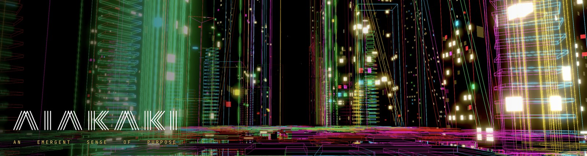
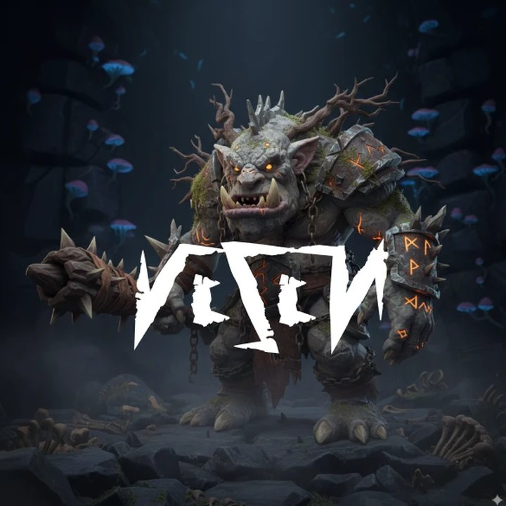
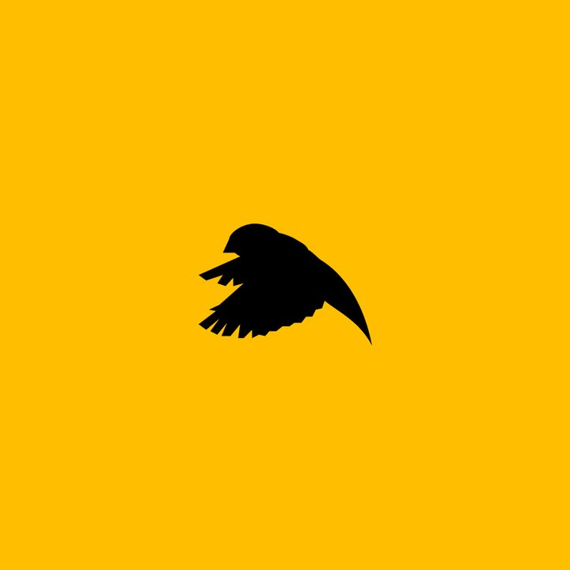
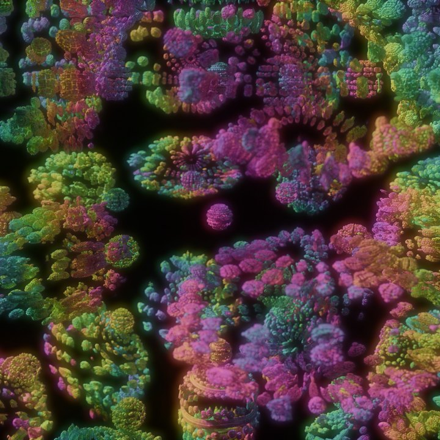

We are leaving the age of information technology, when every system did exactly what we
told it to. What comes next is less certain. We can grip the controls tighter, or we can do
what gardeners have always done: prepare the ground, tend what grows, and let go of the rest.

This is what is growing. Some of it is live, some of it is half built, and some of it is just
for play. Each one says which.

[aiakaki.com](https://aiakaki.com)

 

### 01 · Vesen

*They walk beside you* · **Early testing**

A game of beings that come about from the real world around you: the weather, the time of
night, the season, the place. You go out to find them, meet them, and may bind one. They
know nothing of the human world and learn it only from what happens. For iPhone and Android.

  

### 02 · Publo

*Where stories take shape* · **In the making**

A story graph builder. Connect a hero, a nemesis, a place and a storyline, choose a style,
a language and a reader, and the story emerges from the context you have built.

  

### 03 · Canary

*Previewing the future* · **In the making**

An early-warning system for change. Canary catches weak signals before they become
headlines, places each one on a range of futures, bright and dark, and says what someone
affected could do about it.

  

### 04 · Quixperience

*Knowledge in context* · **Live**

Simple, playful fun. Quixplain is a browser extension that explains whatever you select,
right where you are reading. What you keep lands in a library, with a studio, a quiz engine
and docs that turn what you found into something to play on your phone.

[quixplain.it](https://quixplain.it)

  

### 05 · Nordlys

*A workshop for light* · **For play**

A real-time workshop for light on the GPU: living fractals, path-traced materials, fjords,
galaxies and optics. It is where the effects on [aiakaki.com](https://aiakaki.com) are born.

  

### Who we are

- **John Inge** · [github.com/erlandsen-tech](https://github.com/erlandsen-tech)
- **Morten Brandanger** · [github.com/MortenBrandanger](https://github.com/MortenBrandanger)
- **Pål Machulla** · [github.com/PalMachulla](https://github.com/PalMachulla)

Say hello on [LinkedIn](https://www.linkedin.com/company/aiakaki) or
[Discord](https://discord.gg/TYqrdfeddz).

Aiakaki AS · org. no. 937 074 212 · Feierbakken 1, 1555 Son, Norway
